Before and after, light mode (2/2). Left is `main`, right is this branch.

**Info dot popover**

| Before | After |
|---|---|
| 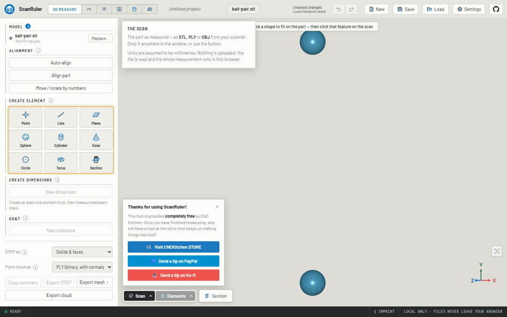 | 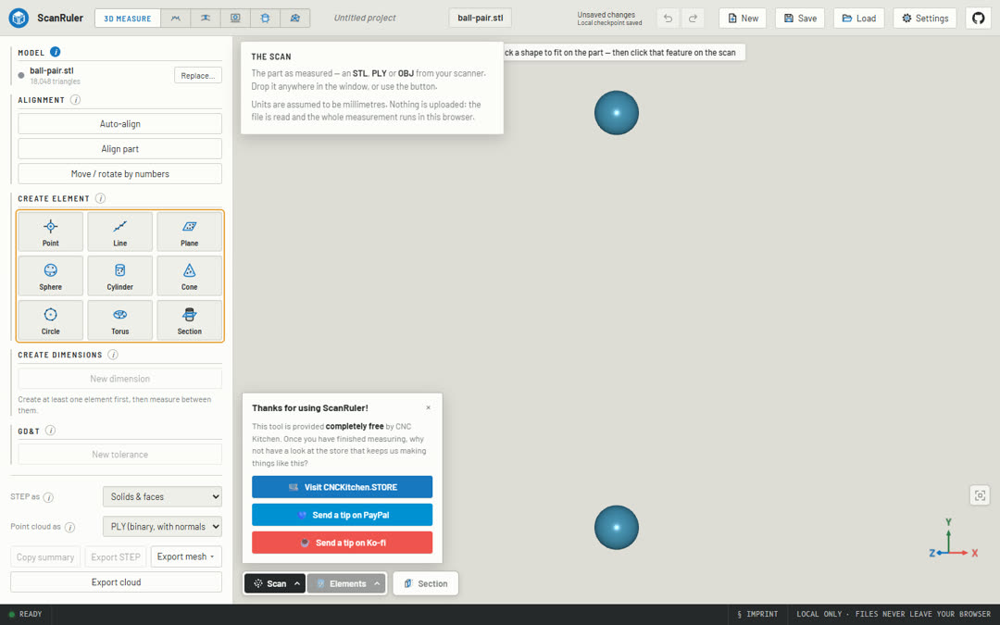 |

**Export mesh menu (full format names)**

| Before | After |
|---|---|
| 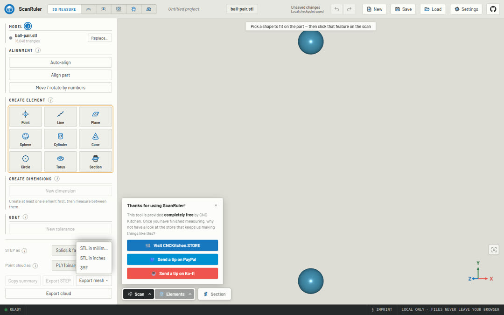 | 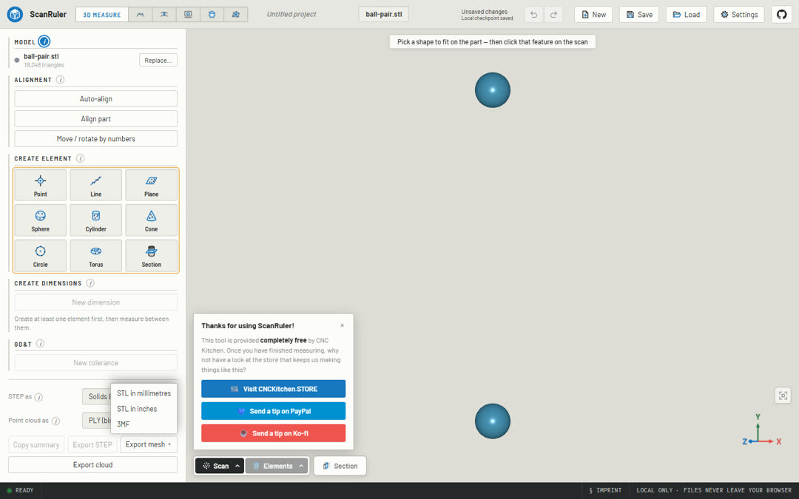 |

**Scan view menu**

| Before | After |
|---|---|
| 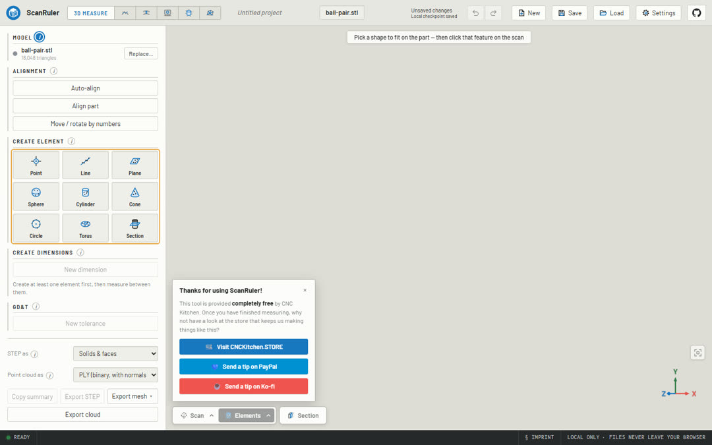 |  |

**Elements view menu**

| Before | After |
|---|---|
|  |  |

**Surface deviation**

| Before | After |
|---|---|
| 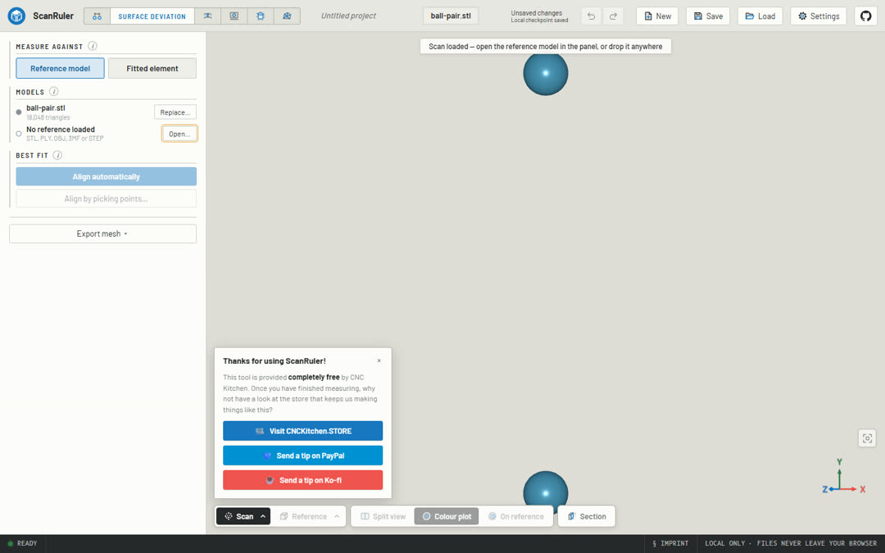 |  |

**Wall thickness**

| Before | After |
|---|---|
|  | 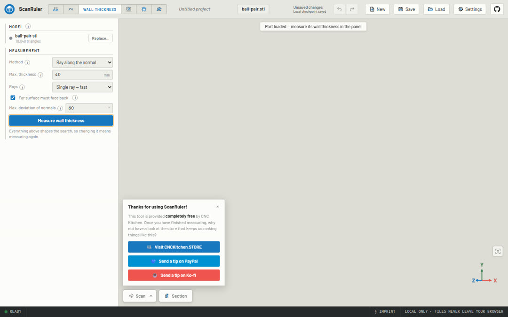 |

**2D Measure**

| Before | After |
|---|---|
| 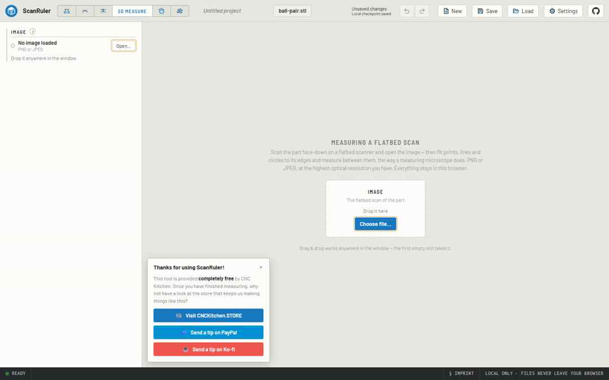 |  |

**Mesh Tools**

| Before | After |
|---|---|
| 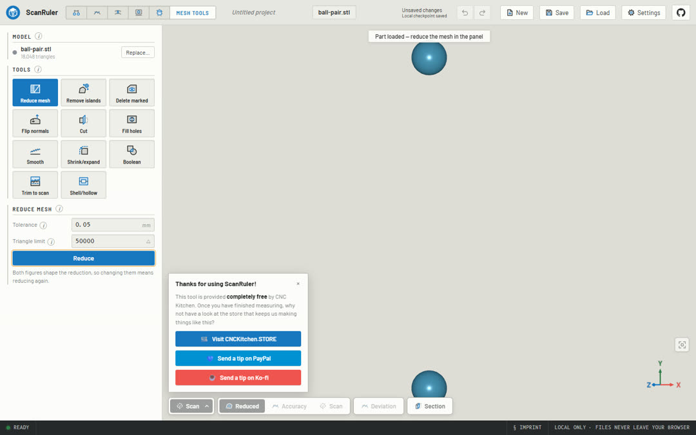 | 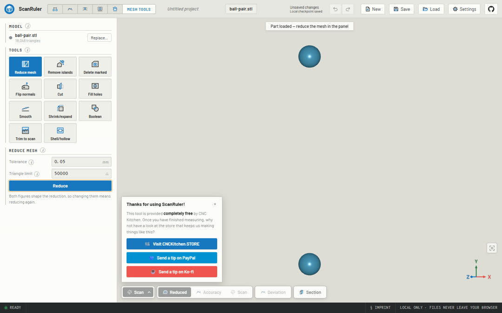 |

**Reverse engineer (Patch network label)**

| Before | After |
|---|---|
| 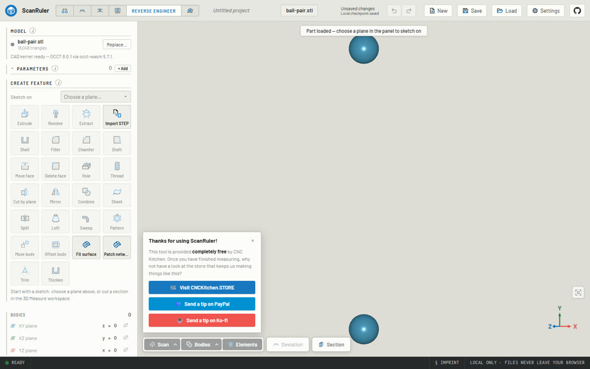 | 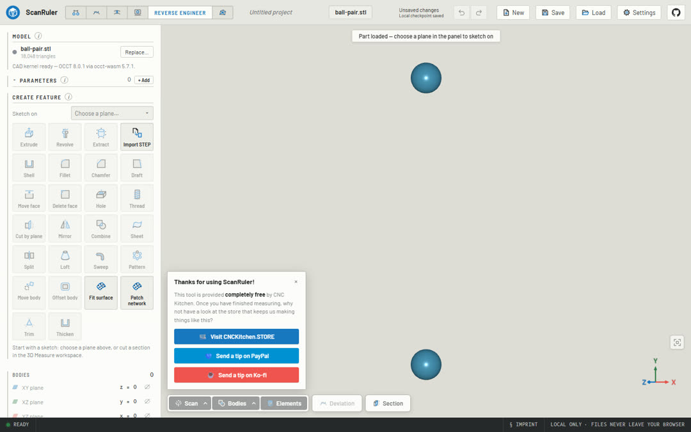 |

**Agent connection warning**

| Before | After |
|---|---|
| 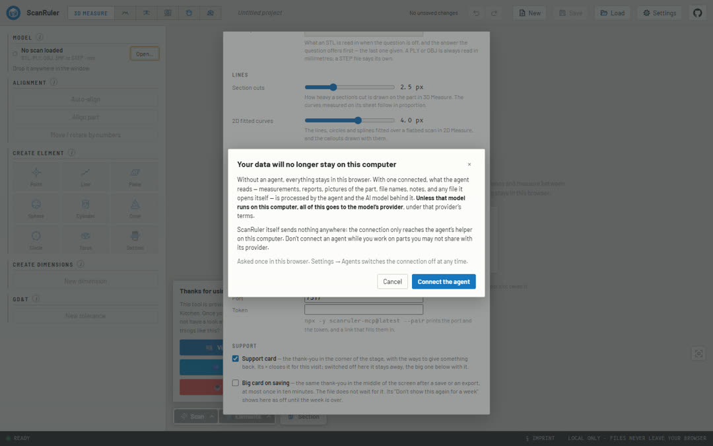 | 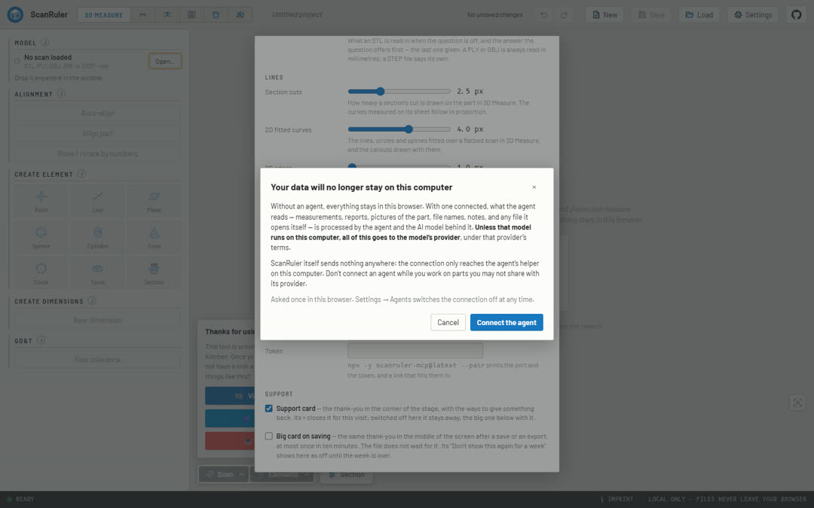 |

